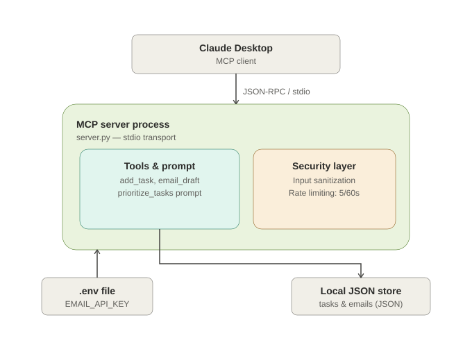

# Personal Productivity MCP Server

Assignment 4 — Calling services: Model Context Protocol

A local MCP server (Python, `mcp` SDK) exposing two tools and a prompt
in the **Personal Productivity** domain: task tracking and email
drafting.



## What it exposes

| Type   | Name                | Description                                                         |
|--------|----------------------|-----------------------------------------------------------------------|
| Tool   | `add_task`           | Adds a task (title, due date, priority) to a local JSON task store   |
| Tool   | `write_email_draft`  | Writes/"sends" an email draft through a simulated authenticated email service |
| Prompt | `prioritize_tasks`   | Turns the current open task list into a prompt asking the LLM for a prioritized daily plan |

## Setup

1. **Create and activate a virtual environment** (in VS Code / Cursor, or manually):

   ```bash
   python3 -m venv venv
   source venv/bin/activate      # Windows: venv\Scripts\activate
   ```

2. **Install dependencies:**

   ```bash
   pip install -r requirements.txt
   ```

3. **Configure secrets:**

   ```bash
   cp .env.example .env
   ```

   Then edit `.env` and set `EMAIL_API_KEY` to any string of 8+
   characters (this is a simulated email service, so no real key is
   needed — but the flow mirrors how a real API key would be handled).
   `.env` is loaded via `python-dotenv` + `pathlib.Path`, never hard-coded
   and never a system-wide environment variable, and is `.gitignore`d.

4. **Run the server directly** (for a quick sanity check):

   ```bash
   python server.py
   ```

   It will idle waiting for an MCP client to connect over stdio — that's expected.

## Connecting from Claude Desktop

Add the contents of `claude_desktop_config.json` to your Claude
Desktop MCP config (Settings → Developer → Edit Config), replacing
`/absolute/path/to/mcp-assignment` with your actual project path
(and pointing `command` at your venv's Python interpreter so the
installed dependencies are found):

```json
{
  "mcpServers": {
    "personal-productivity": {
      "command": "/absolute/path/to/mcp-assignment/venv/bin/python",
      "args": ["/absolute/path/to/mcp-assignment/server.py"]
    }
  }
}
```

Restart Claude Desktop and the `personal-productivity` server should
appear as a connected MCP server with two tools and one prompt.

## Security / best practices implemented

Two of the four listed best practices are implemented, each with a
runnable exploit test that proves it blocks the attack it's meant to stop.

### 1. Input sanitization (`security.py`)

- Rejects SQL/command-injection-style payloads (`; DROP TABLE`, `&&`,
  backticks, `$()`, `../`, etc.) in task titles and email fields.
- Specifically guards `write_email_draft` against **email header
  injection**: a classic attack where an attacker embeds `\r\n`
  (CRLF) in the recipient/subject field to inject extra headers
  (e.g. a hidden `Bcc:`) and hijack the outgoing message.
- Enforces max lengths on every field.

Run the exploit:

```bash
python exploits/test_injection.py
```

Expected output: all four attack attempts are `BLOCKED`, exit code `0`.

### 2. Rate limiting (`security.py`)

- A simple in-memory sliding-window `RateLimiter` caps each tool at
  5 calls per 60 seconds per running server process.
- Prevents a runaway agent loop or a flood of tool calls from
  overwhelming the task store or the (simulated) downstream email
  service.

Run the exploit:

```bash
python exploits/test_rate_limit.py
```

Expected output: the first 5 of 10 rapid `add_task` calls succeed,
the remaining 5 are `BLOCKED`, exit code `0`.

**Limitation:** the rate limiter is in-memory and per-process, so it
resets on restart and doesn't coordinate across multiple server
instances. That's an acceptable trade-off for a single-user local
MCP server, but would need a shared store (e.g. Redis) for a
multi-instance deployment.

### Error disclosure

Both tools return generic error messages ("Too many requests...",
"Email service authentication failed.") rather than leaking internal
details like stack traces, file paths, or why authentication
specifically failed — this wasn't one of the two required practices
but was applied throughout as good hygiene.

## Repository structure

```
mcp-assignment/
├── server.py                    # MCP server: tools + prompt
├── security.py                  # Input sanitization + rate limiting
├── requirements.txt
├── .env.example
├── .gitignore
├── claude_desktop_config.json   # MCP configuration file
├── exploits/
│   ├── test_injection.py        # Exploit demo: input sanitization
│   └── test_rate_limit.py       # Exploit demo: rate limiting
├── docs/
│   └── architecture.svg         # Architecture diagram
└── data/                        # Created at runtime (gitignored)
    ├── tasks.json
    └── sent_emails.json
```

## Code citations

This project was built with AI assistant help (Claude), as required
by the assignment. Sources used as reference:

| Snippet / pattern | Source |
|---|---|
| `FastMCP(...)`, `@mcp.tool()`, `@mcp.prompt()` decorator pattern, `mcp.run()` entrypoint | [Model Context Protocol Python SDK README](https://github.com/modelcontextprotocol/python-sdk) |
| `write_email_draft(recipient_email, subject, body) -> dict` tool shape | Assignment 4 handout hint (course-provided example signature) |
| Secret loading via `python-dotenv` + `pathlib.Path` | [python-dotenv documentation](https://pypi.org/project/python-dotenv/) |
| `security.py` (sanitization functions, `RateLimiter` class) | Original code written for this assignment — no external source |
| `server.py` business logic (task/email storage, tool/prompt bodies) | Original code written for this assignment — no external source |

## AI citation

All code was written/reviewed by the author with AI assistant help as
permitted and required by the assignment instructions; the author can
explain every line.
